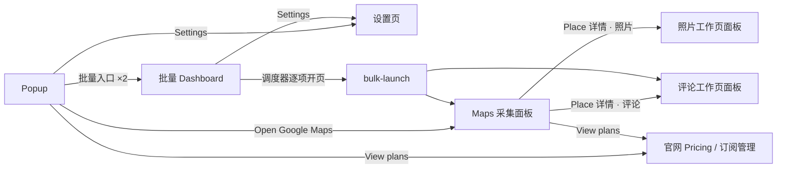
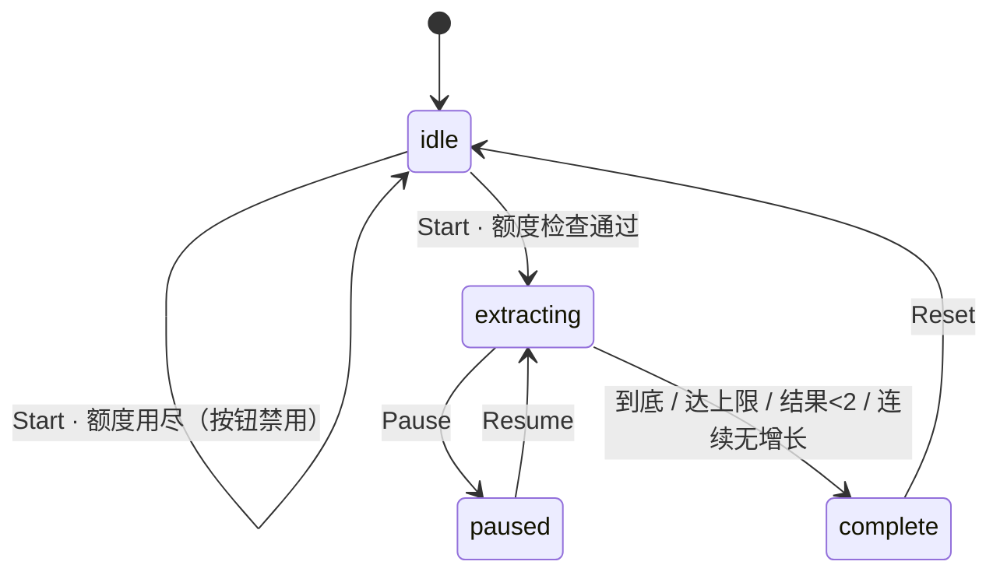
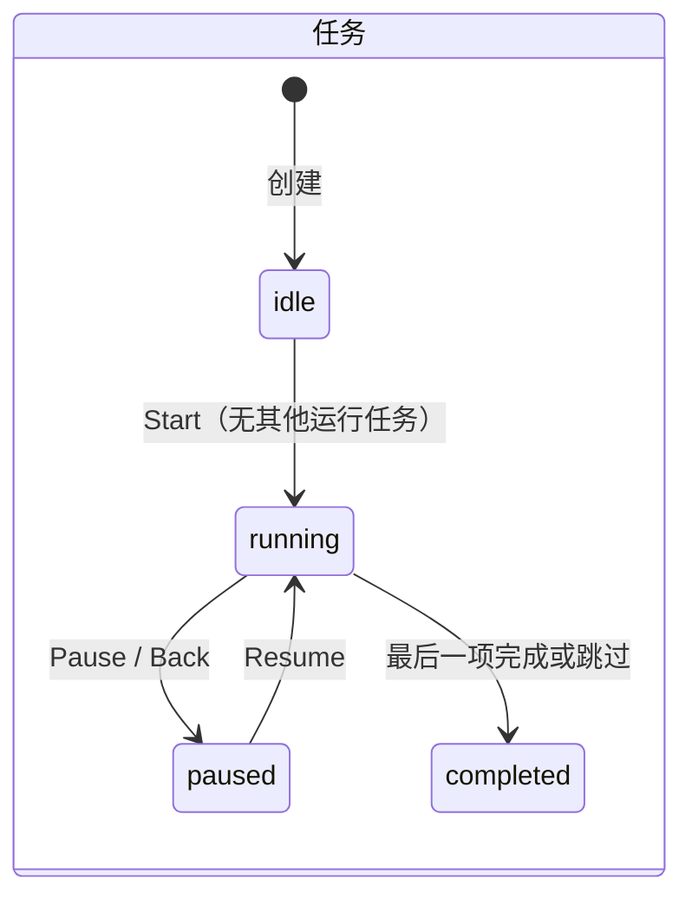
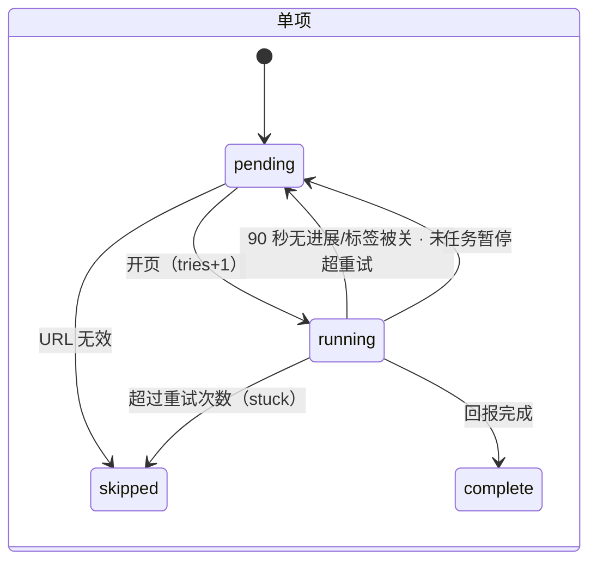

# MapsGrab 插件 · 界面逻辑全景

> Atlas Field 重设计已于 2026-10-18 落地。§1–§7 保留重设计前的界面逻辑快照作为设计输入；§8 记录闭环，§9 记录已落实的调整。当前产品合同见 [013 feat](../../feat/013.Maps插件/feat.md)，实现边界见 [采集与批量技术合同](../../feat/013.Maps插件/tech-采集与批量.md)。

## 1 · 界面地图

插件共 6 个界面，按「用户在哪里」分三组：

| 组 | 界面 | 打开方式 | 载体与尺寸 |
| --- | --- | --- | --- |
| 浏览器工具栏 | **Popup** | 点击工具栏图标 | Vue 页面，宽 400，高随内容 |
| Google 页面内 | **Maps 采集面板** | 打开 `google.com/maps/*`（`/maps/uv` 除外）自动注入 | Shadow DOM 浮层，fixed，宽 236，左/右停靠 |
| Google 页面内 | **评论 / 照片工作页面板** | 从 Place 面板打开的新标签页（评论页 `search.google.com/local/reviews`、照片图库 `/maps/uv`） | Shadow DOM 浮层，固定左侧 |
| 插件内页 | **批量任务 Dashboard** | Popup 两个批量入口（`?type=0` 关键词 / `?type=1` 评论 URL），同类型复用已开标签 | Vue 页面，内容宽 1120 |
| 插件内页 | **设置页** | Popup / Dashboard 的 Settings、浏览器扩展选项 | Vue 页面，内容宽 680 |
| 插件内页 | bulk-launch 跳板页 | 仅批量调度器打开，校验目标 URL 后立刻跳转 | 无样式，只在出错时显示一行文字 |

## 2 · Popup

固定区：品牌头（图标 + MapsGrab、Settings、语言切换 14 语）→ 引导文案 → 主按钮 Open Google Maps → 两个批量入口 → 账号与用量区 → 套餐链接（View plans、Manage subscription）→ 页脚（Help & FAQ、Contact support、版本号）。打开即上报 `popup_open`。

**运营提示**（远程配置下发，读取失败则隐藏）：新版本提示（当前版本低于最低版本）、公告（HTML）。

**账号状态**

| 状态 | 显示 | 操作 |
| --- | --- | --- |
| 访客 | Guest + Sign in | Sign in → 后台拉起官网登录，按钮置灰（文案不变），成功经存储监听即时切换 |
| 登录中 | 同上，按钮禁用 | 30 秒超时或返回后复位，失败静默 |
| 已登录 | 显示名或邮箱 + Sign out | Sign out → 清登录态并撤销会话，即时回到访客 |

**用量状态**（每次打开都实时拉取）

| 状态 | 显示 |
| --- | --- |
| 加载中 | Loading usage… |
| 不可用 | Usage is unavailable + Retry |
| 正常 | `已用 / 总量 records`、4px 进度条、重置周期 |
| 用尽 | 正常态 + 红字「额度用尽，升级继续」 |

登录态变化（任意界面登录 / 登出）→ Popup 即使开着也会重新初始化账号并重拉用量。

## 3 · Maps 采集面板

### 3.1 模式

每秒按 URL 判定模式，模式变化时重建内容并重置停靠方向：

| 模式 | 判定 | 默认停靠 | 内容 |
| --- | --- | --- | --- |
| 搜索 search | 其余 `/maps` 页面 | 左 | 主采集区 |
| 列表 list | URL 含列表标记 `10m1!1e1`（保存列表、侧栏列表） | 左 | 「List Mode」标签 + 主采集区（逐项点开详情采集） |
| 详情 place | 路径含 `/place/` | 右 | 主采集区 + Reviews、Photos 两个入口 |

固定结构：标题 + 左右停靠切换（不持久，换模式即被覆盖）、新版本提示、公告、内容区、页脚。

### 3.2 主采集状态机

| 状态 | 文案 | 主按钮 | 次按钮 |
| --- | --- | --- | --- |
| idle | 引导语（列表模式另有文案） | Start Extracting | — |
| idle · 额度用尽 | 额度用尽提示 | Start（禁用） | View Plans（仅远程配置了 pricingUrl 时出现，默认不出现） |
| extracting | Extracting N… | Export Detailed List - N (.CSV) | Pause |
| paused | Extracting N…（与采集中相同） | Export | Resume |
| complete | Extract complete. | Export | Reset |
| 出错（叠加） | 一律显示 Data parse failed | — | — |

- 本次上限 = min(单次权益, 月余额)，Free 搜索为 10。开始时若在搜索表单页，会重新提交一次搜索。
- 完成时依次：上报用量 → 可选 Email/社媒补全 → 自动导出（开启自动下载或批量模式）→ 可选 Drive/HubSpot → 批量模式回报调度器。
- 批量模式（URL 带批量参数）：面板无专属界面，挂载后自动开始、每批回报进度、完成强制导出。

### 3.3 详情页 Reviews / Photos 入口

| 状态 | 表现 |
| --- | --- |
| 就绪 | Start Extracting Reviews / Photos |
| 进行中 | 按钮禁用，「Collecting in a new tab…」 |
| 额度用尽 | 按钮禁用 + 额度提示 |
| 无法识别地点 | Unable to identify this place… |

评论：从 URL 解析地点 → `window.open` 评论工作页。照片：后台开标签 → 跳原生图库。

## 4 · 评论 / 照片工作页面板

固定左侧，只有标题、提示、错误、Export、Reset。

| 状态 | 文案 | 按钮 |
| --- | --- | --- |
| extracting（挂载即进入） | Extracting N… | Export Reviews/Photos - N (.CSV) |
| complete | Extract complete. | Export + Reset（重查额度期间禁用） |
| 错误（叠加） | 额度用尽 / Data parse failed | — |

- 评论：每页 10 条翻页，到上限、不足一页、无下一页或出错即完成；批量模式每店上限来自任务（默认 300），完成强制导出并回报。
- 照片：图库 10 秒内未就绪则不出面板；过滤街景，导出 Photo URL / Video URL 两列。照片没有批量路径。

## 5 · 批量任务 Dashboard

### 5.1 结构

页头（Bulk Tasks、Settings、Help）→ 工具 tab（关键词 / 评论 URL）→ 视图 tab（New Task / Task History(n)）→ 错误条 / 4 秒自动消失的成功提示 → 三选一视图：**任务详情**（选中任务时）› **新建表单** › **历史列表**。打开时若当前类型有运行中任务，直接进入它的详情。

### 5.2 新建表单

- 任务名（必填）、多行输入（一行一项，去空行、保序去重）、实时计数 `n / 500`；超过 500 显示拆分预览「将保存为 k 个任务」。
- 评论类型另有「每店评论数」100–2500（步长 100，默认 300）。
- 「卡死重试次数」0–9（两类都显示，改动即写全局设置）。
- 按钮：**Create Task**（只保存，跳到历史）/ **Start Extracting**（拆分时变 Start first task，只启动第一个）/ Clear。
- 校验：名称、空输入、总量超 150、服务端额度预估（关键词 ×10、评论 ×每店上限，超余额即拒绝，仅保存也拒绝）。

### 5.3 历史列表

当前类型的任务，新的在前。每行：序号、任务名、状态 chip（Idle / Running / Paused / Completed）+ `已处理/总数` + `try · complete · stuck · skip` 计数、操作按钮（View、Start、Copy completed、Copy pending、Copy all、Delete（原生 confirm））。顶部显示两类合计 `n / 150`。

### 5.4 任务详情

标题 + 状态 chip、运行时提示「保持浏览器开启」、进度条、Pause / Resume、Back（运行中会先暂停）、逐项表（序号、关键词或 URL、状态、记录数）。

### 5.5 调度状态机

同时只运行一个任务；状态持久化，30 秒巡检闹钟兜底恢复；每次状态变化广播给 Dashboard 刷新。

## 6 · 设置页

即改即存，失败显示提示。三组 + 隐私政策页脚：

| 组 | 控件 | 取值（默认） |
| --- | --- | --- |
| 采集 | 滚动间隔 | 5 / 6 / 8 / 9 / 10 秒（8） |
| 采集 | 提取 Email、提取社媒（Pro 标记，代码不拦） | 开关（关） |
| 导出 | 导出格式 | CSV / JSON / XLSX（CSV） |
| 导出 | 导出字段 | 36 列分 6 组（全选），12 列带 Pro 标记 |
| 自动化 | 完成后自动下载 | 开关（关），开启后显示下载目录说明 |
| 自动化 | Google Drive / HubSpot 自动保存 | A10 未决：未配置凭据时禁用占位 |
| 自动化 | 卡死重试次数 | 0–9（1），与 Dashboard 同一设置 |

## 7 · 跨界面联动

| 事件 | 影响 |
| --- | --- |
| 登录 / 登出 | Popup 即时刷新账号与用量 |
| 切换语言 | 三个 Vue 页面即时切换；页内面板静态文案需刷新页面 |
| 改设置 | 面板导出后缀、采集节奏、Dashboard 重试选择即时同步 |
| 用量 | 无推送：Popup 打开时、面板挂载与 Start 时、工作页开始与 Reset 时各自拉取；完成时上报 |
| 批量进度 | 内容脚本回报 → 调度器 → 广播 → Dashboard 刷新 |

## 8 · 缺口闭环（2026-10-18 已落地）

原有进度反馈、错误分类、额度复查、详情入口复位、Popup 用量与登录反馈、Dashboard 操作、语言同步及字体缺口已随 Atlas Field 实现处理；未实现的旧需求描述已从产品合同移除。当前行为以 [013 feat 的界面与操作逻辑](../../feat/013.Maps插件/feat.md#界面与操作逻辑) 为准。

## 9 · 已落地逻辑调整（2026-10-18）

L1–L12 与追加批准项均已落地，范围为 Maps 插件。视觉合同见 [Atlas Field README](README.md)。下表保留设计调整与理由，当前产品行为已同步回 013 feat。

| # | 已落实调整 | 理由 |
| --- | --- | --- |
| L1 | 面板显示本次进度 `N / 上限`（进度环），暂停态改为「已暂停 · N 条」 | 上限已知，进度可视化是动效的主载体 |
| L2 | 错误按原因分文案：未搜索、解析失败、无评论、Google 出错、地点无法识别；错误在下次成功动作时清除 | 「Data parse failed」对用户无行动指引 |
| L3 | 额度用尽恒显示升级入口（默认指向官网 Pricing），额度门在每次 Start 重新判定 | 当前默认无引导，与 feat 不符 |
| L4 | 详情页评论 / 照片入口统一：打开后显示「已在新标签采集」+ 可再次打开，几秒后复位 | 修复评论入口永久卡死 |
| L5 | Popup 增加「接近上限」（≥80%）状态，登录中显示 loading | 用量是 Popup 的核心信息 |
| L6 | Dashboard 历史行：主操作（View / 开始或继续）+ 「更多」菜单（三种复制、删除）；删除改为站内确认弹窗 | 6 个平铺按钮无层级 |
| L7 | 统一叫法：未开始 = Start、暂停后 = Resume、已完成 = Run again（重跑，状态机已支持） | 消除三种叫法；补齐重跑 |
| L8 | Back 不再暂停任务，任务在后台继续，详情可随时回看 | 当前行为与「持久化后台任务」心智冲突 |
| L9 | 卡死重试次数只在设置页配置，Dashboard 表单只读展示当前值并链接设置 | 一个全局设置两处可写易误解 |
| L10 | 插件页打包 Plus Jakarta Sans / Azeret Mono（约 150KB）；页内面板用系统字体 + 等宽数字 | Shadow DOM 内 `@font-face` 不生效，向 Google 页面注入字体代价高 |
| L11 | 设置页增加主题切换（跟随系统 / 亮 / 暗），所有插件界面共享 | Atlas 同款能力；页内面板跟随 |
| L12 | 删除 feat 中未实现的「地图移动更新提示」「转圈」「复制邮箱」描述，以新设计为准 | 文档对齐 |

追加批准项的正式合同：暂停退回本次尝试与 Run again 全量额度检查见 [批量任务流程](../../feat/013.Maps插件/feat.md#批量任务流程)；Exported 回执、补全等待、stopped / empty、只读批量条与 Check again 见 [采集面板](../../feat/013.Maps插件/feat.md#采集面板)；套餐徽章见 [Popup](../../feat/013.Maps插件/feat.md#popup)。
