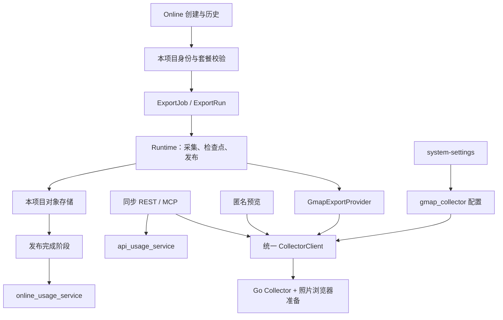

# Export 与 Collector 重构方案

> 本方案已获用户授权实施。采集与导出执行以 CAS 为基线；账号、订阅、订单和月度用量归本项目。执行顺序、源快照归 [007 实施清单](plans/007.Export与Collector重构.md)，当前单元状态与真实联调验证归 [010 执行记录](plans/010.Export服务端实施.md)。

## 1. 重构边界

Online 统一采用 `ExportJob → ExportRun → Runtime → GmapExportProvider → Collector`。迁入 CAS 已有实现并裁掉无关平台与收费耦合，替换现有 Online 父任务、分表 item 和执行服务。旧任务服务不再作为新 Export 的外层包装。

三种业务入口共用一个 Collector 客户端和一份后台采集配置：

| 入口                               | 执行方式                                                         | 本地计量         |
| ---------------------------------- | ---------------------------------------------------------------- | ---------------- |
| Online                             | 持久 Export Job；搜索与官网补全向 Collector 异步提交并查询原调用 | 实际交付 records |
| REST / MCP Search、Reviews、Photos | 保留同步响应，直接调用共享采集客户端                             | 有效请求各计一次 |
| 首页预览                           | 同步 preview，不创建 Job 或文件                                  | 不扣账号额度     |

CAS Export 只实现了 `gmap_search`；Reviews、Photos 是其 Go Collector 已有操作。本方案迁入这三个采集能力，网页异步导出类型沿用已存在的 Search；不把本项目同步 API/MCP 改成 CAS 的异步 MCP，也不宣称源仓已有媒体 Export Provider。

Collector 异步协议以 CAS `docs/feat/023.官网社媒导出/plans/2026-10-20-gmap-collector-async.md` 为目标基线：Online 搜索和官网补全提交后查询原任务；预览与公开同步 API/MCP 继续等待同一执行器的同步响应。

插件浏览器内采集沿用现有链路；插件依赖的官网直连补全保持独立。云端重构不能删除仍被双插件调用的代码。



## 2. 直接复用与适配位置

| 部分                | 采用方式                                                                                                   |
| ------------------- | ---------------------------------------------------------------------------------------------------------- |
| Collector           | 复制Go四操作与浏览器资产，采用CAS异步计划的统一执行器、提交/查询、结果文件与尽力回收                       |
| Google Provider     | 复制 Search item 并发、deadline、结果转换、官网补全和 CSV 列投影；补全开关由本项目权益快照控制             |
| 文件与恢复          | 复制工作 CSV 单写、fsync、检查点、截断恢复、去重扫描、固定产物 hash 与发布核验                             |
| Job / Run / Runtime | 保留 CAS 职责和 owner 分表、编号路由；只保留 Google Search 执行所需字段与状态                              |
| Collector 客户端    | 统一同步/异步协议、原实例查询、有限切换和终态解包；合入本仓Reviews/Photos与当前鉴权边界                    |
| 基础设施            | 直接调用本项目数据库、日志、时区、Redis、对象存储工具与 i18n；代理来源改为后台列表                         |
| Admin               | 复制节点编辑、检查、保存与状态逻辑，用现有 Naive UI 渲染                                                   |
| 本地商业化          | 创建入口读取现有订阅与 usage；发布完成通过原 usage 服务的同事务入口写流水；删除源 CAS 的收费代码与数据字段 |

CAS 当前仍有“未配 Collector 时使用 Python”的搜索与官网回退。迁入时剪除这些分支，空配置明确停用新采集；不复制旧 Python Google 网络实现、gosom、CAS 多社媒 Provider、账号/cookie 池、代理商池或 UI 底座。

本地语言键与源列说明在同一 i18n 边界统一，例如本项目 `ja-JP/ko-KR` 对应源 `ja/ko`；不能直接复制源语言枚举后拒绝本地有效语言。同步 Search 的累计 `page` 在 API 边界按现有每页20条口径映射为 Collector `max_results` 预算，实际分页归采集器，仍按一次有效请求计量。

不迁入 CAS 的积分价格、预扣、退款、余额、计费事实模型，以及匿名 Export、分享下载、XLSX 转换、数量检测 token 和用户追加 Run。这些都不是当前 Google 云端采集与本地收费的必要条件。

## 3. Export 领域与执行

### 3.1 数据归属

- **Job**：本人归属、规范化输入、创建语言、`include_contacts` 权益快照、存储归属及最新结果引用。
- **Run**：一次执行的稳定编号、节点、状态、检查点、已完成 item 事实、固定待发布产物和错误诊断。
- **item**：`options.items` 中的关键词与可选 viewport；完成事实写入 Run checkpoint，不建独立 item 表。
- **Runtime**：只负责调度、调用 Provider、单写 CSV、提交检查点及发布；不判断套餐价格。
- **Provider**：只负责 Google 搜索与可选官网补全；不访问用户余额、不扣量、不生成独立子任务。

创建时直接写 Job 和首个 Run，提交后唤醒 Runtime。一个 Job 只有一轮对外执行；源 `gmap_search` 本身不支持用户 Resume，因此本次不开放追加 Run。`run_seq`、收费基线、列扩张和历史累计合并等仅服务源仓追加执行的内容一起裁掉；保留 Job/Run 的任务与执行职责边界。

普通及地区输入规范化为 `(keyword, 无 viewport)`；地图输入规范化为关键词与去重 viewport 的组合。套餐关键词数按不同关键词计算，逻辑采样数按展开后的 item 数计算，继续使用本项目既有上限；不能把 Free 的关键词数误解释成采样点数。单采样的结果目标采用 CAS `GmapSearchOptions` 默认值，绝不从余额或 CAS 积分预算推导。

### 3.2 采集、文件与状态

采用 CAS 的单 Job CSV、跨 item 商家去重和双行表头。身份优先 Place ID，缺失时使用 Fid；并发 item 按完成顺序提交，先提交项保留该商家及来源关键词，重复行不补采凑满。公开列和语言说明采用源 `gmap_columns`，增加连续行号列。

Run 采用 CAS 的 `QUEUED → COLLECTING → PUBLISHING → COMPLETED / PARTIAL / FAILED`。网页展示终态与局部失败事实，PUBLISHING 显示处理中；不再把所有错误收口都显示为 Completed。零输出成功完成但无下载文件；有有效文件的局部成功交付已有行。

同一 Runtime 是工作 CSV 唯一写入者：先追加并 fsync，再提交 CSV 字节边界、输出行数与 item 完成事实。沿用 CAS 节点内 flock 和节点绑定，工作目录跨发版、进程重启保留。Collector 负责原调用的执行与临时结果，Runtime 负责本地 CSV 和交付；拿到 Collector 终态不等于 item 已提交，也不代表已经扣量。

采集阶段恢复同一 Run：按 DB 已确认字节数恢复工作 CSV 与去重集合，跳过已提交 item；未提交 item 按 §3.3 先查原 Collector 调用，不默认重新采集。已提交的错误 item 不自动重试；已提交文件缺失或变短时失败，不创建空文件伪装恢复。仅同节点恢复，不新增跨节点接管、持久队列或租约。发布阶段的失败与中断按 §4.2 结束，不恢复发布。

为避免问题任务在重启后反复续期，采集与查询总预算使用 Run 首次持久化 `started_at` 加既有一小时预算计算；恢复、查询、切换阶段和重复提交都不刷新截止时间。到期后停止等待及新提交，沿既有局部成功/失败规则收口；官网补全的既有接收余量只接收结果，不增加执行预算。CAS 异步计划仍允许 Server 恢复时刷新业务期限，本项目不沿用该建议。

Runtime 启动只建立后台调度与发现任务，不在 FastAPI 启动流程等待恢复任务全部入队。后台发现本节点 QUEUED/COLLECTING Run，并通过原有有界队列调度；PUBLISHING 仅按 §4.2 失败收口。一个仍在等待 Collector 的任务不能阻止后端进入服务；超过总期限或已结束的任务不通过详情读取、重启或唤醒重新采集。

PUBLISHING 持有固定对象 key、hash、列和行数。上传成功后，用量流水、Job/Run 终态与本人下载引用在同一短事务提交；上传期间不持有数据库事务。上传或结算失败按 §4.2 结束执行，不增加 `uploaded_at` 或发布重试调度。Server执行取消继续传播并释放本地名额，已受理Collector调用按§3.3遵守原执行期限。

### 3.3 Collector 异步调用与恢复

沿用 CAS 计划的一套执行器、任务注册表和结果落盘路径：

| 接口                   | 合同                                                                             |
| ---------------------- | -------------------------------------------------------------------------------- |
| `POST /`               | 同步等待同一执行器，保持原 operation 的状态码与正文；调用方提供 `task_id`        |
| `POST /tasks`          | 新调用受理返回 `202` 与查询位置；同 ID 已有终态返回 `200` 任务信封               |
| `GET /tasks/{task_id}` | `202` 表示排队/执行中，`200` 返回终态信封，`404 task_not_found` 表示没有可用记录 |

终态信封保留原 `response.http_status` 和 operation 正文；外层查询 `200` 不能被解析为空成功。新 ID 为标准库生成的 32 位小写十六进制 UUID；同 ID、相同业务输入复用原执行，不刷新执行期限或结果保留时间，输入冲突返回 `409`。查询仅观察，既不采集也不扣量。全部接口继续用 `X-API-Key` 并禁止响应缓存。

Provider 透传真实 Run 编号用于本地定位；新Collector请求移除旧伪造的 `run_no`，不以调用ID替代Job/Run业务编号。在现有 Run 目录中，按 item 和 `search_item/enrich_sites` 分别保存最小定位文件，仅含 `task_id` 与规范化 `collector_url`。顺序固定为选择原实例、持久保存定位、提交 HTTP；保存失败就不提交。API key 按原地址读取当前配置，不落盘；配置重排不改变恢复地址，地址移除、鉴权或定位文件错误允许失败。定位文件由原文件服务和 Job 锁拥有，不新建调用表或另一套锁。

Server 重启或提交响应丢失时，先向已记录的原实例查询，按固定一秒间隔、短 HTTP 超时及 Run 剩余预算等待：

| 结果                     | 处理                                                                 |
| ------------------------ | -------------------------------------------------------------------- |
| `202`                    | 等待同一调用，不重新提交或领取代理                                   |
| `200`                    | 解包原状态和正文，沿现有成功、局部结果与失败分类继续                 |
| `404 task_not_found`     | 搜索 item 失败；可选官网补全保留基础行，缺失联系方式保持缺失，不重采 |
| 超时、断连或原节点不可达 | 在剩余预算内查原实例，耗尽后失败/降级；不当作 `404`，不跨节点重投    |
| 定位不存在               | 尚无该阶段调用时才允许新提交，使用剩余预算；已有定位损坏不按此处理   |

全新调用保留 client 的有限实例尝试，但只有明确受理前拒绝、或已取回且按既有规则可切换的 Collector 自身错误才切换；每次提交前先保存实际地址。无法确认是否受理时先查原地址，不把超时直接转为下一实例的新执行。官网补全恢复先查原调用，按原响应 URL 合并基础行，不以新的 Redis 未命中组覆盖旧 ID 输入或自动补发批次。

Collector 在首次受理时固定执行期限，任务脱离 HTTP 连接生命周期；Server 停止等待或重启不取消已受理采集。Collector 自身重启允许丢失注册表，即使结果 JSON 仍在也返回 `404`，不扫描文件恢复索引。运行期限与结果保留是两个时钟：终态 JSON 在实例私有 `data/<UTC完成日期>/<task_id>/result.json` 完整发布后，满一小时定期回收；查询不续期，清理前仍可查询。删除失败允许记录日志并人工补清，不增加 ACK、租约、可靠清理或第二份任务数据库。

同步预览及 API/MCP 使用同一执行器，也提供每次逻辑调用的 ID，但不建立 Online Run 定位文件。评论每一页、照片每次独立调用使用不同 ID。Server 取消仍停止本次等待；已受理 Collector 调用可能运行到原期限，不承诺随请求断连取消。CSV 检查点只解决本地已交付进度，不用于恢复 Collector 内部任务。

HTTP 边界归 `provider/gmap/collector_client.py`。`search_item/enrich_sites/list_reviews/list_photos` 提供同步业务结果；`submit_task/query_task` 接收已确定的实例与调用 ID，返回 `None` 表示进行中，终态返回解包后的原正文 bytes，并先按原 HTTP 状态分类失败。`wait_for_task` 在固定接收截止时间内按原实例查询，不提交新任务；短查询超时或断连只在该预算内继续观察。Search 与官网补全分别由 `parse_search_response/parse_contacts_response` 收窄到共享 DTO，失败 Search 不伪装合法零结果，官网补全失败保留基础行由 Provider 负责。定位文件写入、原 URL 对应当前 Key 的选择、Run 固定总期限及 CSV 恢复由 Export 接续，不能直接拿同步方法替代持久调用恢复。

## 4. 本项目收费衔接

### 4.1 保留的真源

账号、商品、订阅、订单、支付渠道及 `monthly_quota` 不迁 CAS。额度总量继续来自本项目订阅配置；用量仍为 `user_usage_logs` 不可变流水，产品线和业务月份归 [统一额度基建](../000.架构/tech-额度基建.md)。不新建收费服务、钱包、余额表或第二份扣费事实。

| 场景                               | 检查与消费                                                                                                                                                         |
| ---------------------------------- | ------------------------------------------------------------------------------------------------------------------------------------------------------------------ |
| 创建 Online Job                    | 检查 `maps_online` 当前用量、关键词/采样权益；已耗尽则拒绝。无预扣、无预留、无退款                                                                                 |
| 联系方式补全                       | 入口按有效 Online 订阅和用户开关固定 `include_contacts`；关闭时不查补全缓存、不调用 enrich                                                                         |
| 发布正数结果                       | 上传成功后以固定产物 `output_count` 调用 `online_usage_service.consume_in_session(db, records=output_count, request_id=job_no)`，与 Job/Run 终态及下载引用一起提交 |
| 合法零结果、全部采集失败或上传失败 | 不写消费流水                                                                                                                                                       |
| 局部成功                           | 仅按实际交付且整 Job 去重后的行数消费；补全失败不另计费                                                                                                            |
| 下载、轮询、采集阶段同 Run 恢复    | 不产生新消费                                                                                                                                                       |
| API / MCP                          | 沿既有共享业务入口检查 `maps_api`；Search 有效结果、Reviews 有效单页及 Photos 有效部分结果各 consume 1，失败不消费                                                 |
| 预览、插件                         | 预览不消费；插件继续归 `maps_extension`，不接入 Export 结算                                                                                                        |

计量月份继续按消费时的 `America/New_York` 自然月。运行中的 Online Job 可超过剩余额度，后续创建按 exhausted 拒绝；本次不增加硬配额截断。

### 4.2 发布与扣量顺序

在新 Runtime 的 PUBLISHING 阶段完成：**固定并上传产物 → 同一数据库事务写用量流水、Job/Run 终态及本人下载引用 → 结束执行**。沿用 CAS 的终态条件更新与短事务结构：先条件更新匹配的 PUBLISHING Run，未命中即结束且不写流水；命中后在同一 session 更新 Job/下载引用、写入本项目用量，最后统一提交。事务内任一步失败整体回滚，不调用会自行提交的 Job/Run 更新方法。

在原 usage 服务增加接收现有 session、不自行 commit 的 `consume_in_session`，沿用 `user_usage_logs`、产品线、业务月份和唯一消费键。现有 `consume()` 会自行提交且继续读取用量快照，不能直接用于此事务；共用原流水写入逻辑，不新建账本。成功收口不需要返回用量快照，不在提交后追加套餐或累计用量查询。

上传或结算异常时记录脱敏日志，仅在 Run 仍处于 PUBLISHING 时尝试一次将 Job/Run 收口为 FAILED，随后释放执行名额；不重采、不重传、不重试结算，不退款或补偿。正常事务失败时流水与成功状态一起回滚；上传成功但事务未提交的对象不公开下载，允许留下未引用文件。

提交响应丢失时以数据库事实为准：用量与成功状态可能已经共同提交，失败收口沿用终态条件更新，不覆盖已提交的 COMPLETED/PARTIAL。数据库不可用时，失败状态也可能无法持久化；记录日志并结束，不轮询。原节点启动或任一唤醒入口再次调度遗留 PUBLISHING 时，只尝试失败收口，不进入上传或结算；正常执行仅在当前调用内从 COLLECTING 进入发布。允许未再次调度的遗留状态保持处理中，不增设巡检或详情读取修复；已结束的失败任务由用户新建任务重试。

不调用旧 `MapsOnlineTaskService.complete_task`，也不把它包在 CAS Runtime 外面。`job_no` 作为唯一消费键依赖本次“一 Job 一 Run”的边界；将来新增用户追加执行时必须同时重新确定增量计量合同，不能直接开放源 Resume 接口。

**计量单位与收费系统保持原合同，计量基数有一项明确变化：**同商家跨关键词重复命中，原来可重复交付与计量；采用 CAS 后在本 Job 只交付、计量一次。不同 Job 之间不去重。

## 5. 单一采集配置

采用 CAS 命名的 `gmap_collector_config_service` 和 `system_data.gmap_collector`，目标配置仅有节点列表及本项目已有代理列表：

```json
{
  "collectors": [{ "url": "http://127.0.0.1:9681", "api_key": "example-only" }],
  "proxies": ["http://proxy.example:8080"]
}
```

配置由 `schemas/gmap_collector_schema.py` 和 `gmap_collector_config_service` 拥有。节点数量上限由 `GMAP_COLLECTOR_MAX_INSTANCES` 定义；URL 规范化为 HTTP(S) 服务根地址，拒绝凭据、路径、查询、片段和重复地址，移除默认端口及末尾斜杠。Key 必填，去首尾空白后只接受可打印 ASCII 且不含空白，以安全用作 HTTP Header。代理格式和逐批检查数量限制复用 `GmapProxyList/GmapProxyCheckRequest`；保存允许空列表，媒体实际调用仍需要代理。空节点列表停用新采集，不回退旧配置。读取直接查该配置行，使节点移除和 Key 轮换及时生效。

Admin 的 system-settings 提供 Collector 节点增删、Key、逐节点检查、保存重读和代理检查，全部使用管理员 Bearer Token。接口合同如下，成功均采用本项目 `{code,data,msg}` 外壳，参数错误走既有本地化校验响应：

| 接口                                                           | 请求                                       | 成功响应 data                                                                                                          |
| -------------------------------------------------------------- | ------------------------------------------ | ---------------------------------------------------------------------------------------------------------------------- |
| GET `/api/admin/system-settings/gmap-collector`                | 无                                         | 上述完整配置对象；未配置时两个列表为空                                                                                 |
| POST 同一路径                                                  | 上述完整配置对象，整体覆盖                 | 规范化后的完整配置；保存后 UI 再 GET 重读                                                                              |
| POST `/api/admin/system-settings/gmap-collector/test`          | 单个 `{url,api_key}`                       | `{ok:true}` 或 `{ok:false,reason}`；reason 为 `timeout`、`transport`、`unauthorized`、`http_error`、`invalid_response` |
| POST `/api/admin/system-settings/gmap-collector/check-proxies` | `{proxies:string[]}`，沿用现有批量检查限制 | `{items:[{proxy,status,status_code,duration_ms}]}`；proxy 不含凭据，status 沿用 `GmapProxyCheckResult`                 |

配置 GET/POST 仅向管理员回显明文 Key 供表单重读，响应为 `Cache-Control: no-store`；UI 按敏感输入展示，不在诊断或提示中回显 Key。逐节点检查仅执行一次带鉴权的 `GET /stats`，响应只返回稳定分类，不保存输入，也不冒充 Google 取数验证；代理检查同样不保存输入。

Export、预览及同步 API/MCP 全部从这一 owner 读取。删除媒体 YAML `maps_collector`、`MAPS_COLLECTOR_*` 部署传参、旧 `gmap_engine` 与 `gosom_api` 服务和界面。切换时一次性保留本项目原代理和有效媒体节点，写入新配置后清理旧值；运行时不双读、不迁移、不回退旧引擎。

Collector 进程的鉴权 Key、监听、队列和资源名额仍由其部署配置拥有；Admin 保存业务端连接凭据。业务节点配置和 Go 进程资源配置职责不同。

首期建议同机 loopback，Supervisor 管理。每个配置地址固定对应一个 Collector 进程及独立实例目录，不使用随机转发到多个进程的负载均衡地址。复制 Go、Node 照片准备及匹配浏览器安装入口；Server Run 目录与浏览器资产跨发版保留，Collector 临时结果目录沿源计划隔离。依赖锁与部署资产清单放实施清单，避免只交一个 Go 二进制却缺失 Photos 运行条件。

## 6. 对外合同变化

以下为已批准的入口、schema、文案与领域合同目标；实际交付状态见执行记录。

| 变化                 | 目标                                                                                                        |
| -------------------- | ----------------------------------------------------------------------------------------------------------- |
| Online 下载          | 每任务一份整任务CSV，替代原每关键词CSV与ZIP；公开API/MCP仍同步                                              |
| 重复商家             | 整 Job 去重，交付行数即 Online 消费基数                                                                     |
| 输出与历史状态       | 采用 CAS 列投影及连续行号，显式展示成功、局部成功、失败；合法零输出无文件                                   |
| 单采样目标与恢复期限 | 采用CAS结果目标；恢复查询原调用，保留已提交item，采集总等待期限从Run首次启动计算，重启不续期                |
| 预览                 | CAS 可进行一次 browser 补列；继续保持本地总预算、最多三行六字段、限流、不落库与不计量                       |
| Claimed              | 有 owner ID 为 YES，否则为空；公开 DTO 对应未知，停止承诺明确 NO                                            |
| 官网补全             | CAS URL 归一化、完整 URL 缓存与直连/代理预算；旧云端域名缓存自然过期，不双读；插件直连不受此变更影响        |
| API 视口             | zoom 收敛为 Collector 可表达的 1–21 整数，入口拒绝非法值，不静默舍入或截断                                  |
| REST / MCP           | 保留同步业务、认证/OAuth和 requests 计量；公开响应外壳和既有字段名由现有 API 层映射，字段语义差异以本表为准 |
| 媒体                 | 保留本仓 Reviews 续页与 Photos 部分交付；不宣称完整相册或照片分页已验证                                     |

网页创建、列表、详情、下载路径与字段类型归 [Online Export 接口](tech-Online任务与结果.md)。地图/地区输入、Online 历史与下载需要随新 Export 一次接线；现有关键词/采样权益与联系方式开关仍从本地套餐取得。新接口只提供当前真实调用所需的创建、列表、详情、本人 CSV 下载；全部使用 GET/POST。不迁入 CAS 的匿名分享下载权限。

## 7. 首次切换

本次没有需要承接的旧 Online 任务或采集产物，直接初始化新 Export 分表。历史编号转换、旧 CSV 合并、历史任务导入与迁移兼容不在本次范围；账号、订单、订阅及用量基建继续使用原体系。

1. 用本项目结构同步工具创建新 Job/Run 分表，配置 Collector、后台连接与工作目录。
2. 在本地完成创建、采集、整任务 CSV、下载和用量入账闭环，再切换后端、Admin与website。
3. 验证新入口后删除旧 Online 模型、任务服务、接口与网站调用，不保留旧任务读写适配。

### 回退截止点

保持新创建入口关闭，验证新模型与配置后再开放。尚未接受新 Export 业务写入时，可以恢复原发布产物与采集配置；代码回滚不会自动恢复 system_data，配置必须随对应发布核对。

开放新业务写入后，故障先关闭创建并保留新 Job、产物及用量流水，采用修复前进。任何阶段都不使用整库快照覆盖账号、订单、订阅和用量；真实目标库的旧空表清理与远端发布另按具体对象执行。

## 8. 已批准的实施边界

- 采用上文 Export 模型、整任务 CSV、全 Job 去重与状态/字段变化；更新既有领域合同，替代旧 Online 专用模型和旧 Collector 草案。
- 采用 Collector 异步提交、原调用查询与固定结果保留；Server 同 Run 恢复先查原地址，未知或预算耗尽允许失败，不自动重采。总等待预算从首次启动计算且不因重启刷新，恢复入队在后台完成。
- 本地收费衔接：原商品与额度体系、无预扣、交付后按去重行数幂等消费，用量与成功终态同事务；用户已确认保留分表，发布失败记录日志并结束，不自动重试；API/MCP继续按请求计量。
- 迁入 Collector 的 Go 依赖锁、独立 Node/Playwright 模块及浏览器运行资产；使用本项目基础工具和 Naive UI，不搬 CAS 收费或无关组件。
- 按首次初始化切换；真实目标库的旧空表清理、配置写入和远端发布在执行前明确对象，不由本次方案审查直接执行。

实施顺序、直接复制文件、删减清单和最少验收见 [007](plans/007.Export与Collector重构.md)。
